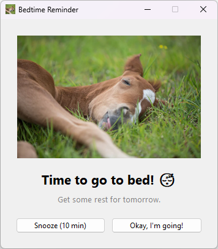
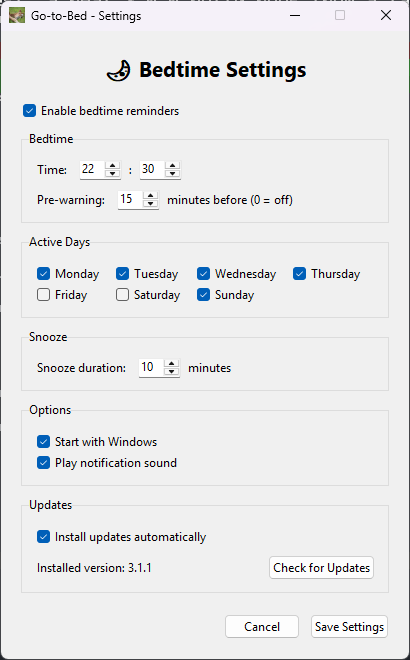
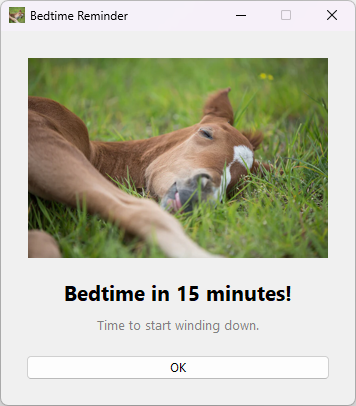
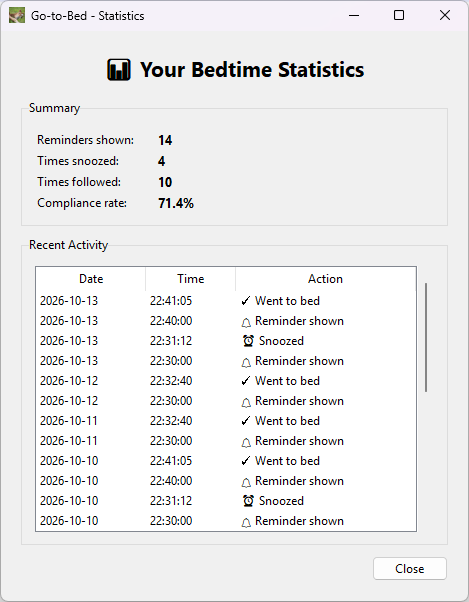

# 🌙 Go-to-Bed

A lightweight bedtime reminder for Windows that lives in the system tray and helps you keep a healthy sleep schedule.

<p align="center">
  
  
</p>

## ✨ Features

- 🖥️ **System tray app** - runs quietly in the background (double-click the icon for settings)
- ⏰ **Flexible schedule** - bedtime plus active weekdays
- 🔔 **Pre-warning** - optional reminder X minutes before bedtime
- 😴 **Snooze** - postpone the reminder for a configurable time
- 🔊 **Sound & Windows notifications**
- 📊 **Statistics** - track how often you actually went to bed
- 🚀 **Autostart** - optionally starts with Windows
- 💤 **Sleep-safe** - reminders missed by up to 5 minutes (e.g. PC was asleep) are still shown
- 🔄 **Auto-update** - checks for new versions at every start and daily, installs them by itself (or asks you), plus a *Check for Updates* button
- 📥 **Installs itself** - no installer and no admin rights needed; Start menu entry and clean uninstall via *Apps & features*

## 📦 Download

Every push to `main` is built automatically by GitHub Actions:

- **Releases**: download `GotoBed.exe` from the [latest release](../../releases/latest) (built for every `v*` tag)
- **Latest build**: open the newest run under [Actions](../../actions/workflows/build.yml) and download the `GotoBed-windows` artifact

The .exe is standalone - no Python needed.

### Installation

Just run the downloaded `GotoBed.exe`. On the first start it **installs itself for your Windows user**:

- copies itself to `%LOCALAPPDATA%\Programs\GotoBed\GotoBed.exe` (no admin rights needed) and starts from there,
- adds **Go-to-Bed** to the Start menu,
- adds an entry under *Settings → Apps → Installed apps* (*Apps & features*) for uninstalling,
- shows *"Go-to-Bed installed"* – you can then **delete the downloaded file**.

If an **older Go-to-Bed is running** (also 3.0.0), it is stopped and replaced automatically; an old `GotoBed.exe` that was used before (e.g. on the Desktop) is deleted and replaced by a **Go-to-Bed shortcut** in the same place. Starting a downloaded file again later just starts the installed version (an older download never replaces a newer installation).

> Windows SmartScreen may warn because the .exe is not code-signed: click *More info → Run anyway*.

> **Coming from 3.0.0?** 3.0.0 cannot update itself, so download 3.1.0 once and double-click it – that's all. It stops the running 3.0.0, installs itself, keeps your settings and statistics, moves the autostart to the installed copy and replaces the old exe with a shortcut. From then on every update is automatic. Step by step: **[Upgrading from 3.0.0 to 3.1](docs/upgrade-from-3.0.md)**.

## 🎯 Usage

On first launch the settings window opens. Afterwards the app sits in the system tray (if you don't see it, click the **^** arrow in the taskbar and drag the horse icon into the visible area). Double-click the icon to open the settings.

### Tray menu

| Entry | What it does |
|---|---|
| **Bedtime: HH:MM** | Shows your configured bedtime |
| **Reminders enabled** | Turns all reminders on/off (also cancels a running snooze) |
| **Settings** | Opens the settings window |
| **Statistics** | Reminders shown / snoozed / followed, recent activity |
| **Test Reminder** | Shows the bedtime reminder right now |
| **Show Data Folder** | Opens `%APPDATA%\GotoBed` (config, stats, log) |
| **Install Update vX.Y.Z** | Only visible when an update is waiting (automatic updates turned off) |
| **Check for Updates** | Checks GitHub right now and offers to install a newer version (same as the button in the settings) |
| **Quit (vX.Y.Z)** | Exits the app and shows the installed version |

Only one instance runs at a time; starting it again shows a hint instead.

### Settings

| Setting | Default | Meaning |
|---|---|---|
| Enable bedtime reminders | on | Master switch, same as the tray entry |
| Bedtime | 21:40 | When the reminder appears |
| Pre-warning | 15 min | Extra reminder this many minutes before bedtime (0 = off, max 120) |
| Active Days | Mon–Fri | Days on which reminders are shown (at least one) |
| Snooze duration | 10 min | How long *Snooze* postpones the reminder (1–120) |
| Start with Windows | on | Starts `GotoBed.exe` automatically after login |
| Play notification sound | on | Windows sound when a reminder appears |
| Install updates automatically | on | Installs new versions without asking; off = you are asked (see [Updates](#-updates)) |

The *Updates* section of the settings also shows the installed version and has a **Check for Updates** button.

### How reminders work

<p align="center">
  
</p>

- At **pre-warning time** a window ("Bedtime in N minutes!") and a Windows notification appear. Just click *OK*.
- At **bedtime** the reminder window appears on top of all other windows, with a notification and sound. You can choose:
  - **Snooze (N min)** – the reminder comes back after the snooze duration (as often as you like).
  - **Okay, I'm going!** – done for tonight. Closing the window counts the same.
- Each reminder appears **at most once per night**.
- If the PC was asleep or the app was started a little late, a reminder that is **up to 5 minutes overdue** is still shown; later ones are skipped.
- **Bedtimes after midnight** work: with bedtime 00:30 on *Tuesday*, the pre-warning appears on Monday evening if it falls before midnight. The active day is the day of the bedtime itself.
- Changing settings takes effect immediately, no restart needed.

### Statistics

<p align="center">
  
</p>

- **Reminders shown** – every bedtime reminder, including those that come back after snoozing
- **Times snoozed / Times followed** – your clicks (closing the window counts as followed)
- **Compliance rate** – followed ÷ shown

The last 100 events are kept.

## 🔄 Updates

Go-to-Bed keeps itself up to date from the [GitHub releases](../../releases):

- It checks **every time Go-to-Bed starts** (a few seconds after the start, so also at every Windows login with autostart) **and once a day** while it runs – only a small request to the GitHub API.
- With **Install updates automatically** on (default), a newer version is downloaded in the background, checked and installed; Go-to-Bed then restarts by itself and shows *"Go-to-Bed updated"*.
- With the setting off, Go-to-Bed **asks you** whether to install it now. If you choose *No*, the tray menu keeps an **Install Update vX.Y.Z** entry.
- The **Check for Updates** button (settings window, *Updates* section) and the tray entry of the same name check right away and ask before installing.
- It never restarts while a reminder is open or a snooze is running – it waits until you're done.

Safety: the download must match the size and SHA-256 checksum published by GitHub, and the new exe is started once in a test mode and must report the expected version before it replaces the old one. If anything fails, the current version keeps running unchanged and the error is in `gotobed.log`.

Because Go-to-Bed lives in your user folder (`%LOCALAPPDATA%\Programs\GotoBed`), updates never need admin rights or a UAC prompt. During an update you may briefly see `GotoBed.new.exe` / `GotoBed.old.exe` there; they are removed automatically.

> Versions before 3.1.0 have no updater – download 3.1.0 once by hand, from then on it updates itself.

## 💾 Your data

Everything is stored in `%APPDATA%\GotoBed\` (tray → *Show Data Folder*):

| File | Contents |
|---|---|
| `config.json` | Your settings. Invalid values are repaired to defaults on start |
| `stats.json` | Statistics and history |
| `gotobed.log` | Log for troubleshooting (max. ~400 KB) |

To move to another PC, copy this folder.

## 🗑️ Uninstall

*Windows Settings → Apps → Installed apps* → **Go-to-Bed** → *Uninstall*.

Go-to-Bed asks whether to also delete your settings and statistics, quits the running app and removes the program folder, the Start menu entry, the autostart entry and the *Apps* entry.

Same from the command line: `"%LOCALAPPDATA%\Programs\GotoBed\GotoBed.exe" --uninstall` (add `--quiet` for no questions; settings are then kept).

## 🐛 Troubleshooting

| Problem | Solution |
|---|---|
| SmartScreen blocks the start | *More info → Run anyway* (the exe is not code-signed) |
| No tray icon | Check the hidden icons (**^** in the taskbar) |
| "Go-to-Bed is already running" | It is already in the tray. To install a downloaded file instead, quit it there first |
| No Windows notification | Windows *Settings → System → Notifications* – allow notifications, check *Do not disturb*. The reminder window appears anyway |
| Update or installation failed | Go-to-Bed keeps running the current version (from where it is). Details in `gotobed.log`; download the new version by hand from the [releases](../../releases) |
| Reminder did not appear | Is today an active day? Was the PC asleep for more than 5 minutes past the time? Look at `gotobed.log` |
| Anything else | Look at `gotobed.log` in the data folder and open an [issue](../../issues) with it |

## 🛠️ Development

Requires Python 3.12. The app targets Windows; on Linux (incl. WSLg) it runs for development only.

```bash
pip install -r requirements-dev.txt
python -m pytest                 # unit tests
python src/main.py               # run the app
python src/main.py --self-test   # open every window once and exit (0 = OK)
python build.py                  # build dist/GotoBed.exe (on Windows; --dist DIR for another folder)
python tools/e2e_update.py OLD_EXE NEW_EXE   # end-to-end test of the updater with two builds
python tools/e2e_install.py EXE  # end-to-end test of self-install + uninstall (on Windows: CI only, it changes HKCU)
python tools/e2e_migrate.py LEGACY_EXE NEW_EXE  # running 3.0.0 -> new version (on Windows: CI only)
python tools/screenshots.py      # regenerate docs/screenshots (Windows only)
```

Environment variables for testing:

| Variable | Effect |
|---|---|
| `GOTOBED_DATA_DIR` | Use this data folder instead of `%APPDATA%\GotoBed` |
| `GOTOBED_UPDATE_URL` | Ask this URL instead of the GitHub API for the latest release |
| `GOTOBED_INSTALL_DIR` | Install into this folder instead of `%LOCALAPPDATA%\Programs\GotoBed` |
| `GOTOBED_ANY_PLATFORM` | Allow self-install and self-update outside Windows (local tests with a Linux build) |

Command line options of `GotoBed.exe`: `--self-test`, `--uninstall [--quiet]`, `--update-now` (install a newer release without UI), `--report-version FILE` (used to verify downloads).

How the code is organised, the threading model and the CI pipeline are described in **[docs/architecture.md](docs/architecture.md)**. Changes per version: **[CHANGELOG.md](CHANGELOG.md)**.

### Continuous integration

Every push to `main`, every pull request and every `v*` tag runs [`.github/workflows/build.yml`](.github/workflows/build.yml) on Windows: tests → self-test from source → build → self-test of the built `GotoBed.exe` → **end-to-end update test** (a second build with version 0.0.1 updates itself to the new exe via a fake release server) → **end-to-end install / uninstall test** → **end-to-end migration test** (a real v3.0.0, built from its git tag, is running and gets replaced by starting the new exe) → artifact upload (→ GitHub release for tags).

### Releasing

1. Bump `__version__` in `src/version.py`, add an entry to `CHANGELOG.md` and – optionally – release notes in `docs/release-notes/vX.Y.Z.md` (shown at the top of the GitHub release, followed by the generated notes); commit.
2. `git push origin main` and wait until CI is green.
3. `git tag vX.Y.Z && git push origin vX.Y.Z` – CI builds the exe and creates the release. The build fails if the tag does not match `src/version.py`.
4. Within a day every running Go-to-Bed (3.1.0 or newer) updates itself to the new release.

If the UI changed, run `python tools/screenshots.py` on Windows before releasing and commit the new images.

## 📝 License

[MIT](LICENSE) – feel free to use and modify!

Sweet dreams! 😴🌙
